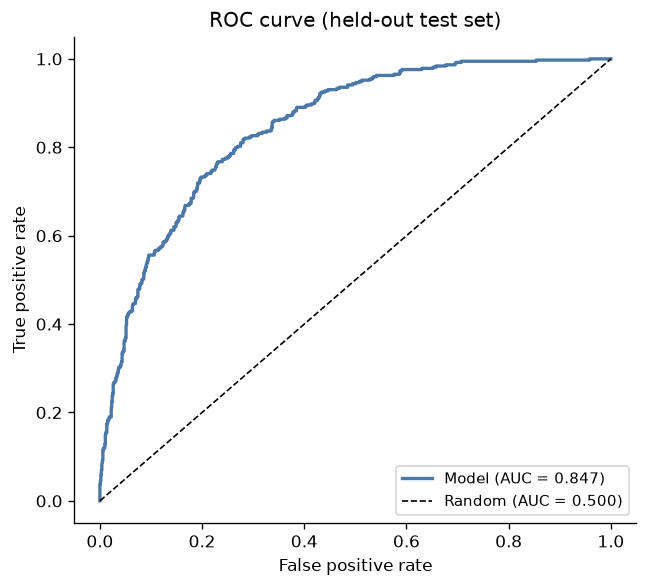
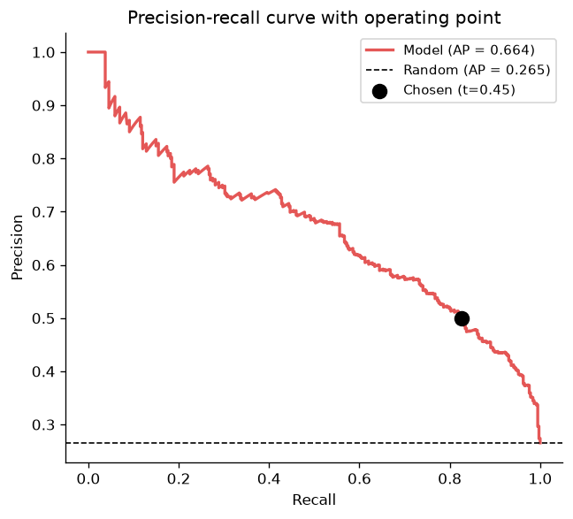
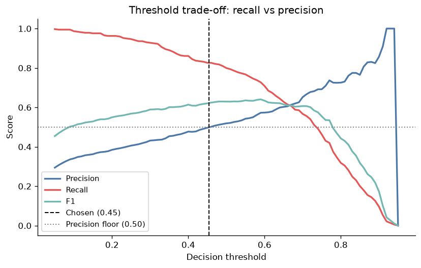
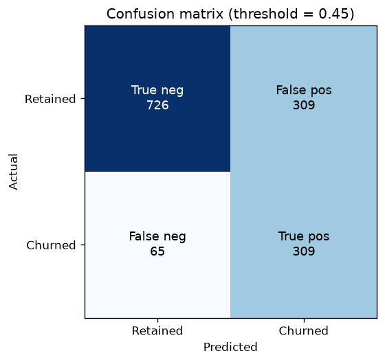
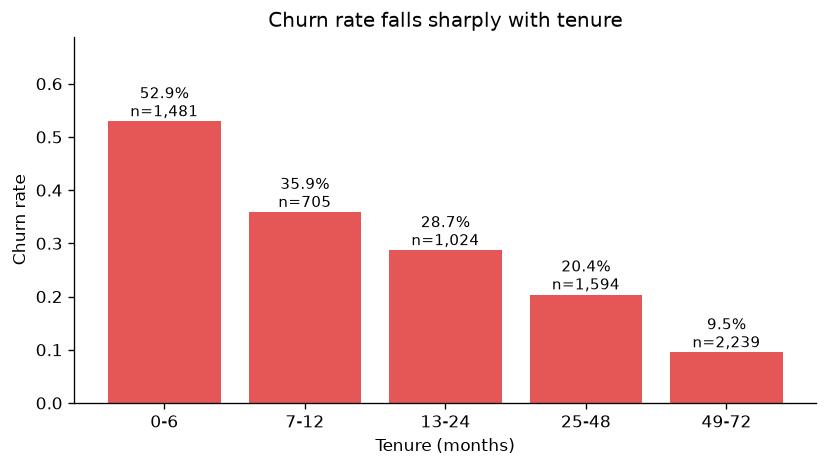
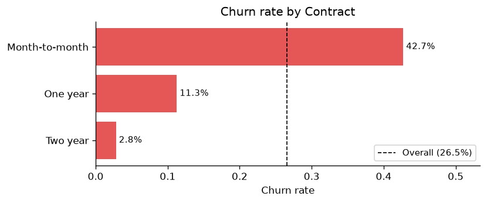
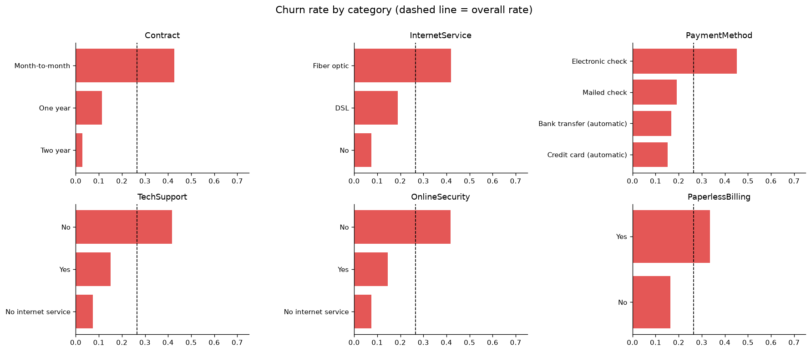
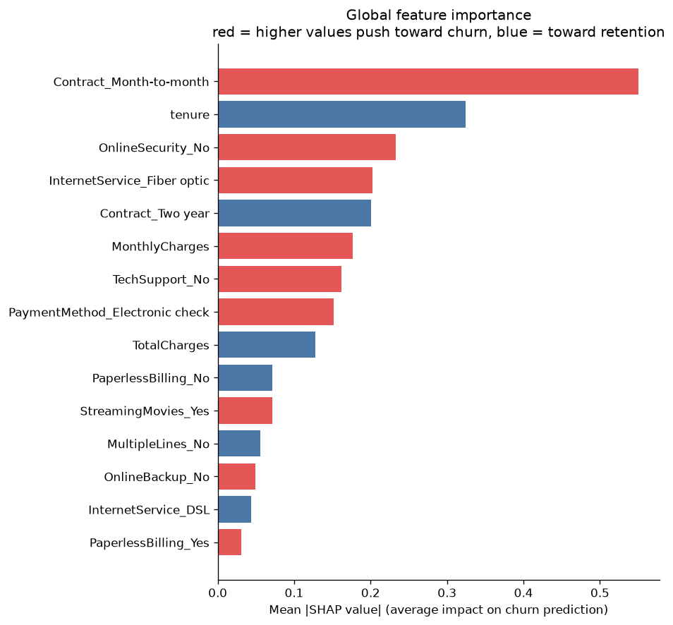
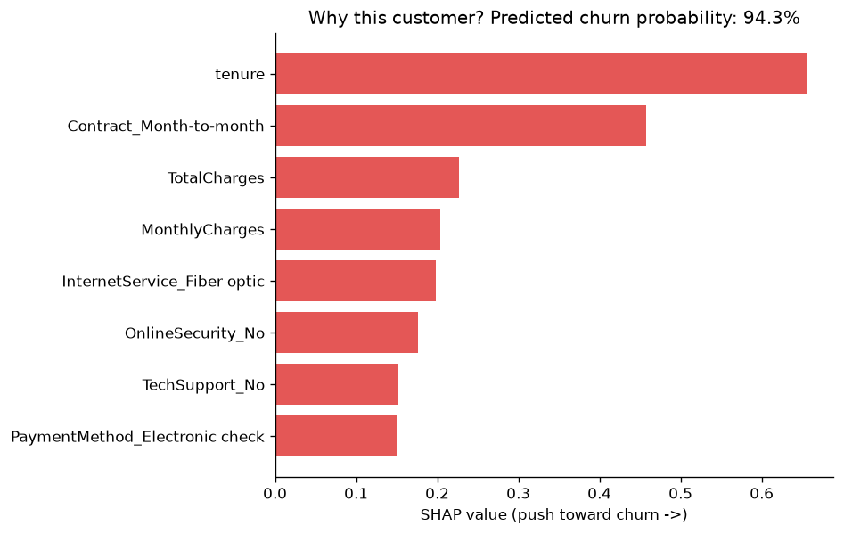

# Telco Customer Churn Prediction

Predicts which telecom customers are about to cancel, explains why for each one,
and serves it over a REST API with a Streamlit front end.

On held-out data the model catches **82.6% of churners** (ROC-AUC 0.847) at a
threshold deliberately tuned away from the 0.5 default, because missing a
churner costs a lot more than sending someone an unnecessary discount.

Data: [IBM Telco Customer Churn](https://www.kaggle.com/datasets/blastchar/telco-customer-churn),
7,043 customers, 19 features.

## Why this problem is trickier than it looks

Only 26.5% of these customers churn. So a model that predicts "nobody leaves"
gets **73% accuracy** and is completely useless. That one fact drives most of
the decisions in here: why the metrics are ROC-AUC and PR-AUC instead of
accuracy, why the models use class weighting, and why the decision threshold
isn't 0.5.

## Results

5-fold stratified CV on the training split, each model tuned with a randomised
search. Preprocessing is refit inside every fold so nothing leaks.

| Model | ROC-AUC | PR-AUC | Recall | Precision |
|---|---|---|---|---|
| XGBoost (picked) | 0.850 ± 0.011 | 0.669 ± 0.022 | 0.799 | 0.525 |
| Random forest | 0.848 ± 0.010 | 0.662 ± 0.019 | 0.791 | 0.523 |
| Logistic regression | 0.846 ± 0.013 | 0.659 ± 0.019 | 0.800 | 0.516 |

Held-out test set, 1,409 customers:

| | threshold 0.50 | threshold 0.455 |
|---|---|---|
| ROC-AUC | 0.847 | 0.847 |
| PR-AUC | 0.664 | 0.664 |
| Recall | 0.799 | **0.826** |
| Precision | 0.519 | 0.500 |
| Accuracy | 0.750 | 0.735 |

At the tuned threshold it catches 309 of 374 churners and misses 65. Compared
to the default that's 10 more churners caught in exchange for 32 more false
alarms. Accuracy drops, which is fine, accuracy was never the point.

XGBoost only beat the logistic baseline by 0.004 ROC-AUC. That's worth being
upfront about: the signal in this dataset is mostly linear and categorical, so
a plain logistic regression gets you almost all the way. I kept XGBoost because
it won the comparison, but if this were going into production I'd probably ship
the logistic model and take the simplicity.




### Picking the threshold

The two mistakes don't cost the same. A false negative means a customer walks
and you never saw it coming, so you lose their whole remaining value. A false
positive just means you discounted someone who was staying anyway. So the
threshold maximises recall while holding precision at 50% or better, which
keeps at least half of the flagged customers genuine and stops a retention
campaign from being mostly wasted budget.




## What's in the data

Full analysis in [notebooks/01_eda.ipynb](notebooks/01_eda.ipynb). The things
that actually mattered:

Churn is heavily front-loaded. Customers in their first six months churn at
52.9%; past four years it's down to 9.5%. Tenure ends up being the strongest
numeric predictor (correlation -0.35).



Contract type is the biggest single lever, and the one finding here that maps
straight onto something a business can act on. Month-to-month customers churn
at 42.7%, two-year contracts at 2.8%.



Fiber optic customers churn at 41.9%, about double DSL's 19.0%. The premium
product has the worst retention, which seems more like a pricing or
service-quality question for the business than something to just feed the
model.

Churners pay more per month ($74.44 vs $61.27) but have lower lifetime totals,
because they leave early. `TotalCharges` turns out to be largely a stand-in for
tenure.

Customers without TechSupport or OnlineSecurity churn above average, so the
add-ons look like they make people stickier.



## What the model is actually using



In order: month-to-month contract, tenure, no online security, fiber optic, two
year contract, monthly charges, no tech support, electronic check payment.

Those line up with the EDA, which is reassuring, it suggests the model picked up
on real structure rather than noise. The per-customer version is the part that
would actually be useful to a retention team, since "88% risk" on its own
doesn't tell anyone what to say on the call.



## Layout

```
config.yaml              all paths, seed, split, threshold
src/churn/
  config.py              typed config loader
  data.py                loading and cleaning
  eda.py                 plots + insight numbers
  features.py            preprocessing pipeline
  train.py               training, tuning, model comparison
  evaluate.py            held-out metrics, threshold selection
  explain.py             SHAP
  predict.py             inference, risk bands
api/main.py              FastAPI service
app/
  client.py              HTTP helpers (unit tested)
  streamlit_app.py       UI
notebooks/01_eda.ipynb   EDA, outputs committed so charts show on GitHub
reports/                 metrics.json + figures
tests/                   101 tests
```

## Setup

Python 3.10+. Built and tested on 3.14.

```powershell
python -m venv .venv
.\.venv\Scripts\Activate.ps1      # source .venv/bin/activate on mac/linux
pip install -r requirements.txt
pip install -e .
```

The `-e .` is needed for the `python -m churn.*` commands to resolve.

Download the Telco CSV to `data/telco_churn.csv`. The path is in `config.yaml`
if you want it somewhere else.

```powershell
python -m churn.data                        # clean, print a summary
python -m churn.train --tune                # compare models, save the winner
python -m churn.evaluate --write-threshold  # metrics, pick threshold, save plots
python -m churn.explain                     # SHAP
python -m churn.predict                     # score one example customer
```

`--tune` runs the randomised search and takes a few minutes. Without it you get
default hyperparameters, and the logistic baseline wins instead.

## Demo

Two terminals.

```powershell
uvicorn api.main:app --host 127.0.0.1 --port 8000
```

```powershell
streamlit run app/streamlit_app.py --server.address 127.0.0.1
```

Then http://localhost:8501. There are preset high and low risk profiles in the
sidebar so you don't have to fill in 19 fields to see it work. Interactive API
docs are at http://127.0.0.1:8000/docs.

The `--server.address` flag is there on purpose, Streamlit listens on all
interfaces by default.

```
POST /predict
{"gender":"Female","SeniorCitizen":0,"tenure":2,"Contract":"Month-to-month",
 "InternetService":"Fiber optic","MonthlyCharges":94.35, ...}

{"churn_probability": 0.88,
 "will_churn": true,
 "threshold": 0.4549,
 "risk_band": "critical",
 "recommended_action": "Immediate outreach with a strong retention offer"}
```

There's no auth on the API. It's a local demo, but it would need an API key,
rate limiting and TLS before going anywhere near a network.

## Tests

```powershell
pytest
```

101 tests. The ones worth knowing about cover the `TotalCharges` blanks, that
preprocessing is refit per fold rather than once up front, unseen categories at
inference time, threshold selection behaviour, and the API's 422 paths. The API
tests skip themselves if there's no trained model on disk so a fresh clone
still runs clean.

## A few decisions I'd defend

The saved artifact is the entire pipeline, not just the estimator. Preprocessing
and model go into one joblib file, so there's no way for the API to scale
features differently than training did. That's a nasty class of bug to debug in
production.

Cross-validation wraps the pipeline rather than the model, so scalers and
encoders refit on each fold. Fitting the scaler once on everything before
splitting is the easy mistake and it quietly inflates your scores.

The threshold gets written back into `config.yaml`, which means the number I
evaluated at is the same number the API serves at. Keeping those in sync by hand
is asking for trouble.

The one-hot encoder uses `handle_unknown="ignore"` so a payment method the model
has never seen encodes as zeros instead of raising a 500.

For SHAP direction I ended up using the correlation between a feature's value
and its SHAP value. My first attempt used the signed mean SHAP value and every
single feature came out as "reduces churn", which took me a while to work out:
most customers don't churn, so almost everything has a negative average
contribution.

## Next

Calibration is the obvious gap. The ranking is fine but I haven't checked
whether 0.88 actually means 88%, and `CalibratedClassifierCV` would fix that.
Matters if the number ever feeds an expected-value calculation.

Beyond that: swap the precision floor for real numbers (customer lifetime value
against offer cost) and pick the threshold that maximises expected profit;
try some lifecycle features like average spend and cohort deltas; and a
Dockerfile plus CI if this were going to be deployed rather than demoed.

## Data

IBM Telco Customer Churn, from the
[IBM sample data repo](https://github.com/IBM/telco-customer-churn-on-icp4d),
also [on Kaggle](https://www.kaggle.com/datasets/blastchar/telco-customer-churn).
Not committed here.
